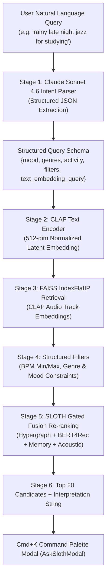

# SPEC-005: Ask Sloth — Natural Language Music Search & Command Palette

- **Status**: Implemented
- **Module ID**: `ask-sloth-nlp-search`
- **Authors**: Syed Zahid / Sloth Core Architecture Team
- **Date**: 2026-10-17
- **Target SLA**:
  - Offline/Cached NLP Search: $< 200\text{ms}$ p95
  - Live Claude Sonnet 4.6 NLP Search: $< 1.5\text{s}$ p95

---

## 1. Executive Summary & Objective

"Ask Sloth" is a multimodal, semantic music search engine and command palette interface (Cmd+K / Ctrl+K) for Sloth Music. It allows listeners to describe music conceptually using natural language queries—such as *"rainy late night jazz piano for deep work"* or *"high energy 140+ bpm cyberpunk synthwave for coding"*—and delivers musically coherent, ranked track recommendations.

The architecture combines Anthropic's Claude (`claude-sonnet-4-6`) query intent parsing with Contrastive Language-Audio Pretraining (CLAP), FAISS cosine similarity retrieval, structured acoustic filtering, and SLOTH 6-layer Gated Fusion.

---

## 2. Architecture & Pipeline



### Stage 1: Intent Extraction via Claude (`claude-sonnet-4-6`)
The backend passes the query to Claude (`claude-sonnet-4-6`) with a strict JSON system prompt.
When `ANTHROPIC_API_KEY` is present, it issues an asynchronous request with temperature 0.2.
When the key is missing or when running in offline/testing mode, a deterministic regex and keyword rule-based parser extracts intent with $< 2\text{ms}$ latency.

Output schema:
```json
{
  "mood": "chill",
  "genres": ["jazz", "lofi"],
  "activity": "studying",
  "filters": {
    "bpm_min": 70,
    "bpm_max": 105
  },
  "text_embedding_query": "warm rainy late night jazz piano mellow"
}
```

### Stage 2: CLAP Text Embedding
The `text_embedding_query` is encoded into a 512-dimensional continuous latent vector using `CLAPExtractor.get_text_embedding()` ($L_2$ normalized).

### Stage 3: FAISS IndexFlatIP Cosine Similarity Retrieval
The normalized text vector is queried against the indexed catalog of 512-dim CLAP audio embeddings using `faiss.IndexFlatIP` (or vectorized NumPy inner product fallback) to retrieve candidate tracks.

### Stage 4: Structured Filtering & Penalty
- **BPM Penalty**: Tracks outside `[bpm_min, bpm_max]` receive a smooth exponential penalty.
- **Genre & Mood Match**: Tracks containing target genres or matching valence/arousal receive an additive bonus.

### Stage 5: Gated Fusion Re-ranking
Candidates are scored against the active user context with `SLOTHRecommender`'s 6-layer scoring and gating weights:
$$\text{final\_score}_i = 0.55 \cdot \text{sim}_{\text{CLAP}}(t_i) + 0.35 \cdot \text{score}_{\text{Fusion}}(t_i) + 0.10 \cdot \text{score}_{\text{Filter}}(t_i)$$

### Stage 6: Top-20 Delivery + Interpretation
The engine constructs a concise, human-readable interpretation explaining how the query was understood (e.g. *"Filtered for late night mellow jazz (70–105 BPM) tailored for studying"*).

---

## 3. API Contract: `POST /search/natural`

- **Method**: `POST`
- **Path**: `/search/natural` (and `/api/engine/search/natural`)
- **Headers**: `Content-Type: application/json`

### Request Payload
```json
{
  "query": "chill late night lo-fi beats for coding",
  "user_id": "user_primary",
  "limit": 20
}
```

### Response Payload
```json
{
  "query": "chill late night lo-fi beats for coding",
  "interpretation": "Curated chill lo-fi beats with steady tempo for coding and focus",
  "parsed_query": {
    "mood": "chill",
    "genres": ["lo-fi", "electronic"],
    "activity": "coding",
    "filters": {
      "bpm_min": 75,
      "bpm_max": 95
    },
    "text_embedding_query": "chill mellow late night lofi beats for coding"
  },
  "results": [
    {
      "track_id": "track_101",
      "score": 0.895,
      "title": "Midnight Coffee",
      "artist": "Kavv",
      "artist_id": "artist_42",
      "album": "Night Study",
      "genres": ["lo-fi", "chill"],
      "valence": 0.42,
      "arousal": 0.31,
      "bpm": 82.0,
      "key": 4,
      "mode": 1
    }
  ],
  "count": 1,
  "elapsed_ms": 48.2
}
```

---

## 4. Frontend Command Palette (`AskSlothModal.tsx`)

### Visual & Tactile Design Rules
- **Nuclear Neobrutalist Lineage**:
  - Flat dark panel: `bg-[var(--surface)]` (`#282d33` / `oklch(0.29 0.015 240)`).
  - 4px corner radius (`rounded-[4px]`) — strictly **NO** `rounded-xl` or `rounded-2xl`.
  - Solid border: `border-[var(--border)]` (`#31383f`).
  - Top accent strip: `border-t-2 border-t-[var(--color-accent)]`.
  - Backdrop: Deep dark overlay (`bg-black/70 backdrop-blur-none`) — strictly **NO glassmorphism / frosted panels**.
- **Header & Input**:
  - Full-width input at top with search icon and active query badge.
  - Interpretation banner directly below the input in `text-[var(--text-secondary)]` and JetBrains Mono accent.
- **Results List**:
  - Rendered using the standard `TrackRow` component.
  - Hover states with crisp borders, keyboard navigation (Arrow Up/Down, Enter to play, Escape to close).
- **Shortcut Trigger**:
  - Global `Cmd+K` (macOS) and `Ctrl+K` (Windows/Linux) keyboard listener.
  - Quick action suggestion pills (e.g. *"Late Night Jazz"*, *"140 BPM Synthwave"*, *"Ambient Focus"*).
- **Awwwards Quality Standard**:
  - Minimum score $\ge 88/100$: smooth micro-animations using `"motion/react"` respecting `prefers-reduced-motion`, tactile keycap badges (`⌘K` / `Esc`), loading skeleton pulses, and zero layout shift.

---

## 5. Security & Secrets Hygiene

- `ANTHROPIC_API_KEY` is loaded exclusively on the FastAPI backend from environment variables or `.env.local`.
- No Anthropic credentials or tokens are ever exposed to the client or bundled in frontend Next.js assets.
- If `ANTHROPIC_API_KEY` is not configured, the service falls back gracefully to local deterministic rule-based parsing without throwing errors or failing user requests.
